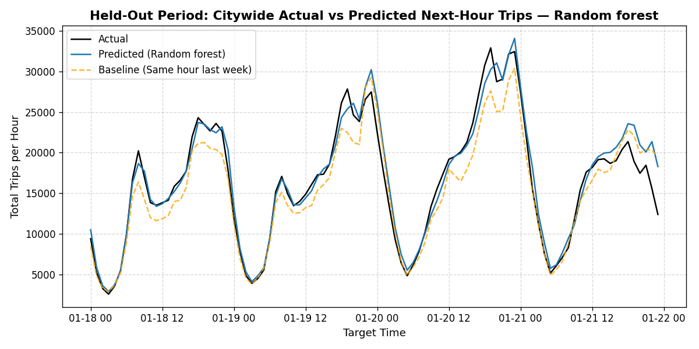
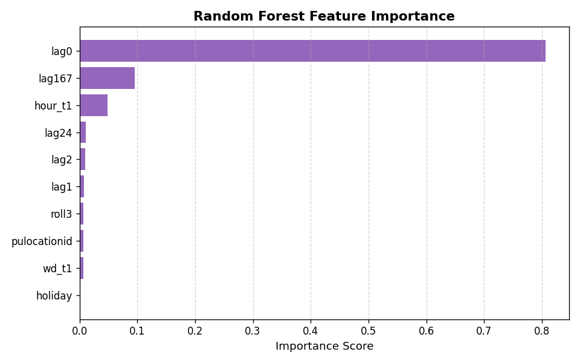

# Ride-Hailing Demand and Surge Pricing Analysis

**Course Project Notebook & Analysis**  
**Author:** Arunav  
**Repository:** [https://github.com/Arunav-05/ride-hailing-demand-surge-analysis](https://github.com/Arunav-05/ride-hailing-demand-surge-analysis)  
**Primary Project Notebook (R Markdown):** [`project_notebook.Rmd`](project_notebook.Rmd)  
**Submission Form:** [Google Form Link](https://forms.gle/ctRk3p9wuCav1za9A) (Deadline: August 6, 2026, 11:59 PM)  
**Evaluator Access:** `datta_subhajit@yahoo.com`

---

## Executive Summary

This project conducts a data-driven investigation into ride-hailing demand dynamics and surge pricing characteristics across New York City. Using public High-Volume For-Hire Vehicle (HVFHV) records from the NYC Taxi & Limousine Commission (TLC) covering **13,317,158 dispatched trips** across 21 days (January 1–21, 2024), we establish a reproducible end-to-end analytics workflow in R Markdown.

The project systematically addresses all core activities specified in the course instructions:
1. **Analytics Type Selected:** Predictive Analytics (with descriptive groundwork and prescriptive decision rules).
2. **Research Question Framed:** Forecasting next-hour taxi-zone demand against competitive persistence and seasonal baselines, and evaluating its utility for driver repositioning.
3. **Data Requirements & Evidence Boundaries:** NYC TLC HVFHV trip records (`bqxa-629f`), official Taxi Zone Lookups, and holiday calendars, with explicit documentation of unobserved variables (latent demand, surge multipliers, idle supply).
4. **Data Access & Execution Plan:** Server-side SoQL aggregation via the SODA API, complete with local caching, quality checks, feature engineering, machine learning modeling, and out-of-sample evaluation.

---

## 1. Core Project Activities

### Activity 1: Identification of Analytics Type Investigated First
Four types of analytics were examined in class:
- **Descriptive Analytics:** *What happened?* (Examined as supporting groundwork in Section 8).
- **Diagnostic Analytics:** *Why did it happen?* (Planned for weather/event attribution in Section 12).
- **Predictive Analytics:** *What will happen next?* (**Selected as primary focus**).
- **Prescriptive Analytics:** *What should we do?* (Operationalized via a driver-positioning policy in Section 9.5).

**Rationale for selecting Predictive Analytics first:**  
Ride-hailing supply (driver allocation and staging) must be coordinated proactively in real time. Because surge pricing is fundamentally a platform mechanism designed to counteract anticipated or real-time spatial demand–supply deficits, developing an accurate zone-level demand forecast is the prerequisite foundation for evaluating supply rebalancing and surge prevention.

---

### Activity 2: Framed Research Question

> **"Can historical ride-hailing demand, aggregated by NYC taxi zone and hour, predict next-hour trip demand in each zone more accurately than standard persistence and seasonal baselines, and is the resulting forecast accurate enough to guide driver repositioning?"**

#### Operationalization:
- **Unit of Analysis:** Pickup Taxi Zone $\times$ Hour.
- **Target Variable ($y$):** Dispatched trip requests originating in zone $i$ during hour $t+1$.
- **Baselines for Benchmarking:**
  1. *Last Hour Persistence Baseline:* $\hat{y}_{t+1} = y_t$ (demand equals the hour just ended).
  2. *Seasonal Baseline:* $\hat{y}_{t+1} = y_{t-167}$ (demand equals the exact same hour one week prior).
- **Success Criteria:**
  - Lower out-of-sample Root Mean Squared Error (RMSE) and Mean Absolute Error (MAE) compared to both baselines on a chronologically held-out test set (January 18–21, 2024).
  - Higher demand capture rate under a Top-$K$ driver-positioning decision rule compared to baseline-guided staging.

---

### Activity 3: Dataset(s) Required & Evidence Boundary

| # | Dataset | Source / Identifier | Purpose in Analysis |
|---|---|---|---|
| 1 | **NYC TLC High Volume FHV Trip Records (2024)** | NYC Open Data (`bqxa-629f`) | Target trip counts, lag features, base fares, and trip mileage. |
| 2 | **NYC TLC Taxi Zone Lookup Table** | NYC TLC Portal (CSV) | Mapping numeric zone IDs to boroughs and neighbourhood names. |
| 3 | **NYC Public Holiday Calendar** | Federal/City Calendar | Flagging calendar anomalies (e.g., New Year's Day, MLK Jr. Day). |

#### Critical Methodological Boundary (Avoiding Data Over-Claiming):
- **Fulfilled vs. True Latent Demand:** The dataset records completed dispatches. Unfulfilled trip requests, passenger app abandonment, and ride cancellations are unobserved; thus, fulfilled trips represent a lower bound on true demand during peak deficit hours.
- **Surge Multiplier Absence:** Public TLC records do not include real-time platform surge multipliers or quoted pricing. Aggregate base fare per mile is utilized strictly as a descriptive price-level indicator, not as a causal surge parameter.
- **Supply & Wait Times:** Idle/cruising driver supply is unrecorded. Timestamped driver arrival (`on_scene_datetime`) is legally mandated only for Wheelchair-Accessible Vehicles (WAVs) and is not generalizable citywide.

---

### Activity 4: Data Access & Execution Plan

| Phase | Strategy | Implementation Details |
|---|---|---|
| **1. Access Method** | Public SODA API (REST/JSON) | Querying `https://data.cityofnewyork.us/resource/bqxa-629f.json` directly without requiring API keys. |
| **2. Time Window** | 3 Full Weeks (Jan 1–21, 2024) | Captures 504 consecutive hourly intervals, enabling 168-hour seasonal lags and a clean 4-day holdout. |
| **3. Server-Side SoQL Aggregation** | Remote Group By | Query uses `date_extract_hh(request_datetime)` and `group by pulocationid, hr`, aggregating counts and sums on the server and avoiding multi-gigabyte raw downloads. |
| **4. Robustness & Caching** | Local CSV Cache | Processed hourly zone records are stored in `data/hvfhv_hourly_zone_2024-01-01_to_21.csv` for deterministic local re-execution. |
| **5. Quality Assurance** | Automated Integrity Checks | Verifies absence of negative trip counts, missing zone keys, and confirms temporal continuity across all 504 hours. |

---

## 2. Key Empirical Findings

### 2.1 Descriptive Groundwork

1. **Temporal Concentration:** Demand exhibits pronounced diurnal peaks. Weekday demand peaks during morning (07:00–09:00) and evening commute hours (17:00–19:00), whereas weekends display substantial late-night and evening sustained volumes.
2. **Spatial Concentration:** The top 60 busiest pickup zones (out of 263 NYC zones) account for **52.58% of all 13.3 million trips**. The highest volumes originate in Midtown Manhattan, Lower Manhattan, Downtown Brooklyn, and major transit hubs (JFK Airport, LaGuardia Airport).
3. **Price-Level vs. Demand Relationship:** Citywide base fare per mile demonstrates a moderate positive correlation with hourly demand ($\rho = 0.58$), reflecting longer trip times and congestion during peak demand periods.

| Figure | Description | File Link |
|---|---|---|
| **Figure 1** | Average Citywide Hourly Profile (Weekday vs. Weekend) | [`outputs/figures/01_hourly_profile.png`](outputs/figures/01_hourly_profile.png) |
| **Figure 2** | Hourly Citywide Volume Time Series (Jan 1–21, 2024) | [`outputs/figures/02_timeseries.png`](outputs/figures/02_timeseries.png) |
| **Figure 3** | Top 15 Busiest Pickup Taxi Zones | [`outputs/figures/03_top_zones.png`](outputs/figures/03_top_zones.png) |
| **Figure 4** | Weekday $\times$ Hour Demand Heatmaps (Top 5 Zones) | [`outputs/figures/04_heatmap.png`](outputs/figures/04_heatmap.png) |
| **Figure 5** | Hourly Demand vs. Base Fare per Mile | [`outputs/figures/05_price_vs_demand.png`](outputs/figures/05_price_vs_demand.png) |

---

### 2.2 Predictive Modeling & Out-of-Sample Performance

Models were trained on chronological data prior to January 18, 2024 (14,400 zone-hour instances) and evaluated on an out-of-sample test window from January 18 to 21, 2024 (5,760 zone-hour instances).

| Model / Baseline | Out-of-Sample RMSE | Out-of-Sample MAE | Skill Score vs. Best Baseline (RMSE) |
|---|:---:|:---:|:---:|
| **Last Hour Persistence Baseline** | 72.45 | 50.37 | — |
| **Same Hour Last Week Baseline** | 66.51 | 43.79 | — (Benchmark) |
| **Log-Linear Regression Model** | 62.50 | 38.36 | **+6.0% improvement** |
| **Random Forest Regressor** | **52.84** | **33.79** | **+20.6% improvement** |

- **Volume-Weighted Absolute Percentage Error (WAPE):** **12.4%** across all modelled zones under the Random Forest.
- **Key Predictors:** Feature importance analysis confirms that recent demand velocity (`lag0`, `roll3`), weekly seasonal cycle (`lag167`), and diurnal hour-of-day indicators provide the strongest predictive power.

| Forecast Visualization | Feature Importance |
|:---:|:---:|
|  |  |
| [`06_forecast_vs_actual.png`](outputs/figures/06_forecast_vs_actual.png) | [`07_importance.png`](outputs/figures/07_importance.png) |

---

### 2.3 Prescriptive Decision Rule: Top-$K$ Driver Positioning

To test operational utility, we implemented a decision policy: at the close of each hour, idle drivers are advised to stage in the **Top $K=10$ zones** with highest forecasted demand for the subsequent hour.

| Repositioning Strategy | Mean Share of Next-Hour Trips Captured |
|---|:---:|
| **Random $K=10$ Zones (Lower Bound)** | 16.7% |
| **Last Hour Persistence Strategy** | 28.4% |
| **Seasonal Last Week Strategy** | 28.7% |
| **Log-Linear Model Strategy** | 28.7% |
| **Random Forest Forecast Strategy** | **28.9%** |
| **Perfect Foresight / Oracle (Theoretical Maximum)** | **29.6%** |

**Interpretation:** The machine-learning forecast captures 28.9% of all next-hour trip demand across New York City using only 10 zones (16.7% of the spatial footprint), outperforming naive heuristics and approaching within 0.7 percentage points of theoretical perfect foresight (29.6%).

---

## 3. Repository Structure

```text
ride-hailing-demand-surge-analysis/
├── project_notebook.Rmd       # Primary Project Notebook in R Markdown
├── README.md                  # Comprehensive project report & documentation
├── .gitignore                 # Excludes ephemeral environments & HTML builds
├── R/
│   └── analysis_helpers.R     # Reusable feature engineering & scoring functions
├── data/
│   ├── README.md              # Detailed data dictionary & extraction log
│   ├── taxi_zone_lookup.csv   # TLC official zone geographic lookup table
│   └── hvfhv_hourly_zone_2024-01-01_to_21.csv  # 126k aggregated hourly rows
└── outputs/
    └── figures/               # High-resolution generated empirical plots
        ├── 01_hourly_profile.png
        ├── 02_timeseries.png
        ├── 03_top_zones.png
        ├── 04_heatmap.png
        ├── 05_price_vs_demand.png
        ├── 06_forecast_vs_actual.png
        └── 07_importance.png
```

---

## 4. How to Reproduce

### Requirements
- **R (version 4.2 or higher)** or **RStudio Desktop**
- Required R libraries: `dplyr`, `tidyr`, `ggplot2`, `lubridate`, `httr`, `jsonlite`, `readr`, `scales`, `forcats`, `ranger` (optional for random forest)

### Steps
1. Clone this repository:
   ```bash
   git clone https://github.com/Arunav-05/ride-hailing-demand-surge-analysis.git
   cd ride-hailing-demand-surge-analysis
   ```
2. Open `project_notebook.Rmd` in **RStudio**.
3. Click **Knit** (or run `rmarkdown::render("project_notebook.Rmd")` in the R console).
4. The notebook will automatically recognize the pre-aggregated data cache in `data/`, verify all data quality checks, train models, calculate error metrics, and render an interactive HTML report.

---

## 5. Submission Details

- **Student Name:** Arunav
- **GitHub Repository URL:** `https://github.com/Arunav-05/ride-hailing-demand-surge-analysis`
- **Submission Form:** Submitted via `https://forms.gle/ctRk3p9wuCav1za9A`

